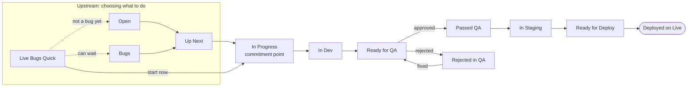

Every task lives on the **"Flow" board** in the ClickUp list **FluxPrompt Platform Dev**. This page explains what each status means, when a task enters it, and who owns it. Status names are in English, exactly as they appear in ClickUp.

<Note>
The team guide has the same flow with more context: rules, metrics, and the proposals the team is still discussing. See the [team guide](https://claude.ai/artifact/7Cc2XCerrvzYSc6hF8QZwq). This page only lists what is in use today.
</Note>

## The flow at a glance

Work comes in through two doors: **Up Next** (planned work) and **Live Bugs Quick** (possible bugs reported by the client).

## Upstream: choosing what to do

Nothing here is a commitment yet. Lead time hasn't started.

| Status | What it means | Who owns it |
| - | - | - |
| **Open** | Product requests, priorities, and ideas from the client. The Brazil team can add items too, letting the client know. | Client team (US), led by Brad and Evan |
| **Bugs** | A triaged bug waiting for priority. Moves to Up Next when it gets priority. | Brad and Evan decide the priority |
| **Up Next** | The product queue, in order. Devs pull from the top. | Brad and Evan set the order |
| **Live Bugs Quick** | Possible bugs reported by the client, waiting for a quick first look. After that look, the item goes straight to In Progress, or waits in Bugs or Open. | Client (US) and Brazil team |

## Downstream: doing the work

Move a card only when the git side is true. A card in Ready for QA promises that QA can test it on dev right now.

| Status | What it means | Git side | Who owns it |
| - | - | - | - |
| **In Progress** | The commitment point. The dev refines the ticket, documents it, and builds the first version. Lead time starts here. | Feature branch from `main` | Brazil team devs |
| **In Dev** | The change is merged into dev. An open PR isn't enough. | Feature branch merged into `develop` | Brazil team devs |
| **Ready for QA** | The dev deploy finished and the change is live on dev. QA tests it there. | Dev deploy finished | Client QA (US): Brad, Evan, Justin, and Bradley |
| **Rejected in QA** | QA found a problem. The reason goes in a comment. After the fix, the task goes back to Ready for QA. | Fix merged into `develop` again | Brazil team devs |
| **Passed QA** | QA approved the change. Moves on to In Staging. | | Brazil team |
| **In Staging** | The change is on staging, on its way to production. Sometimes the Brazil team tests here, sometimes the client. | Feature branch merged into `staging` | Varies |
| **Ready for Deploy** | Ready to go to production. | PR into `main` reviewed and merged | Brazil team |
| **Deployed on Live** | In production. The task is done. The Deployed Date fills in automatically when the card moves here. | Production workflow run on `main`, rollout checked, deploy announced | Brazil team, at deploy time |

The commands for each step are in [Git workflow](/getting-started/git-workflow).

### Paused

A task that stopped after In Progress goes to **Paused**. When it's unblocked, it goes back to the status it was in.

<Warning>
After In Progress, a task doesn't go back upstream. If it's stuck, move it to Paused instead of back to Up Next or Open.
</Warning>

## Deploys

- **Any day except Friday.** On Fridays, only critical fixes or urgent issues go to production.
- The Brazil team deploys, usually one person per day. Everyone should know how.
- A production deploy ships everything merged into `main`. Merge a PR into `main` only after its task passed QA.
- After a production deploy, post the announcement in the team's Google Chat, one line per ClickUp task. The `deploy-announcer` agent writes it for you.

## Meetings that move the board

| When | What |
| - | - |
| Every weekday at 10:30 BRT | Daily of the Brazil team |
| Monday, Wednesday, Friday at 13:30 BRT (14:30 BRT when the US is off daylight saving time, early November to mid-March) | Client meeting |
| Every two weeks | Retro with emergent topics |

## Related

- [Git workflow](/getting-started/git-workflow): branches, PRs, and deploy commands
- [How we work](/getting-started/welcome/culture): code review and conventions
- [Team guide](https://claude.ai/artifact/7Cc2XCerrvzYSc6hF8QZwq): the full flow, rules, metrics, and the ticket standard
