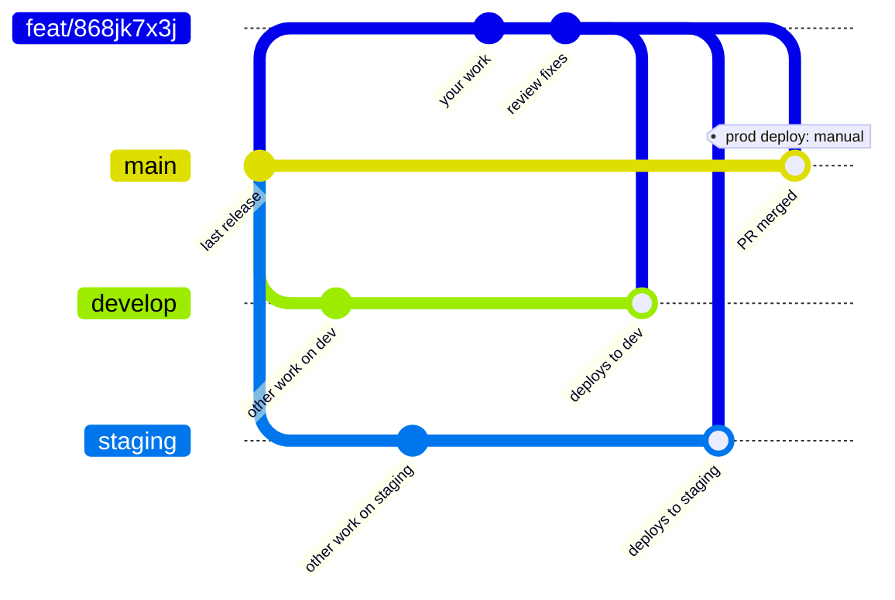
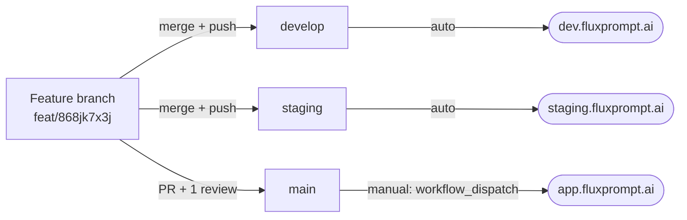

<Note>
**Branch names changed on 2026-10-13.** Every product repo now uses `develop` (dev), `staging`, and `main` (production). The old `production` and `master` branches still exist but are frozen: never branch from them, merge them, or open a PR against them. In `front/`, `main` used to be dev and is now production, so any older note that says otherwise is wrong.
</Note>

This page is the reference for branches and deploys. For the AWS details (ECS topology, resizing a task definition), see the [PR and deploy flow](/ai-workflows/internal-developer-workflows/playbooks/pr-and-deploy-flow) playbook.

## Repos and branches

| Repo | Folder in the workspace | What it is | Dev | Staging | Production |
| - | - | - | - | - | - |
| `Flux-Prompt` | `back/` | API (NestJS) | `develop` | `staging` | `main` |
| `Flux-Prompt-Frontend` | `front/` | Frontend (React) | `develop` | `staging` | `main` |
| `Flux-Prompt-Worker` | `worker/` | Worker (Temporal) | `develop` | `staging` | `main` |
| `FLuxPrompt-MCP` | `mcp-server/` | MCP server | `develop` | `staging` | `main` |
| `docs` | `docs/` | This site | | | `main` |
| `Workflow` | workspace root | Agents, skills, and team scripts | | | `main` |

In `docs` and `Workflow`, `main` is the only branch. This site doesn't deploy on merge: someone clicks **Deploy** in the [Mintlify dashboard](https://dashboard.mintlify.com/enhancedai-ee242787/enhancedai-ee242787).

## Environments

| Environment | App | API | MCP | How it deploys |
| - | - | - | - | - |
| Dev | `dev.fluxprompt.ai` | `api-dev.fluxprompt.ai` | `mcp-dev.fluxprompt.ai` | Automatically on every push to `develop` |
| Staging | `staging.fluxprompt.ai` | `api-staging.fluxprompt.ai` | `mcp-staging.fluxprompt.ai` | Automatically on every push to `staging` |
| Production | `app.fluxprompt.ai` | `api.fluxprompt.ai` | `mcp.fluxprompt.ai` | Only by hand, with `workflow_dispatch` on `main`. A merge into `main` deploys nothing |

The MCP dev and staging servers shut down at 20:00 every day, so a 503 after hours is expected.

## Naming

- **Branch:** `<change_type>/<task_code>`, where `change_type` is `feat`, `fix`, or `refactor` and `task_code` is the ClickUp task ID. Example: `feat/868jk7x3j`. Use the same branch name in every repo the task touches.
- **PR title:** `[FEAT] Imperative task name` (or `[FIX]`, `[REFACTOR]`).
- **PR body:** Description, Preview, References. The `pr-creator` agent writes it.
- The repos don't use version tags.

## The flow



Your feature branch is the source. It goes into `develop` and `staging` by a direct merge, and into `main` through a reviewed PR. Changes never flow from `develop` or `staging` back into your branch.

Where each branch deploys:



## Step by step

<Steps>
  <Step title="Branch from main">
    Before you start, check that nobody already has a branch for the task.
    ```bash
    git fetch origin
    git branch -r | grep 868jk7x3j
    git checkout --no-track -b feat/868jk7x3j origin/main
    ```
  </Step>
  <Step title="Test on dev">
    When the change works locally, merge your branch into `develop`:
    ```bash
    git fetch origin
    git checkout develop
    git reset --hard origin/develop
    git merge --ff-only feat/868jk7x3j   # use a plain merge if a fast-forward isn't possible
    git push origin develop
    ```
    The push deploys dev. Wait until the deploy finishes before you move the task to Ready for QA. Dev deploys use the organization's GitHub Actions minutes, so test locally first and push to dev to confirm, not to iterate.
  </Step>
  <Step title="Promote to staging">
    After the task passes QA, do the same with `staging`:
    ```bash
    git fetch origin
    git checkout staging
    git reset --hard origin/staging
    git merge --ff-only feat/868jk7x3j
    git push origin staging
    ```
  </Step>
  <Step title="Open the PR into main with pr-creator">
    ```
    use the pr-creator agent — https://app.clickup.com/t/868jk7x3j
    ```
    The agent finds the branch in each repo, runs `scripts/check-no-dev-in-prod-pr.sh`, writes the title and body, and opens the PR against `main`. Fill in **Preview** with screenshots or logs before you ask for review. If the task touches `back/` and `front/`, open both PRs and ship them together.
  </Step>
  <Step title="Get one review and merge">
    One teammate reviews each PR. Answer every comment before you merge. Comments marked `nit:` are optional. Merging into `main` doesn't deploy anything.
  </Step>
  <Step title="Deploy to production">
    Run the production workflow on `main` in each repo you changed:
    ```bash
    gh workflow run cicd_prod.yml --ref main     # back/ and worker/
    gh workflow run cicd-prod.yaml --ref main    # front/
    gh workflow run cicd_prod.yml -f ref=main    # mcp-server/
    ```
    The run deploys everything on `main`, not only your PR. **No production deploys on Fridays**, except critical fixes or urgent issues.
  </Step>
  <Step title="Announce it">
    Ask the `deploy-announcer` agent to write the message, or `pr-creator` if it opened the PRs in this session. Paste it in the team's Google Chat:
    ```
    Hey team, I just deployed the following to production:
    - <Task name> — https://app.clickup.com/t/<task_code>
    Please give me a shout if anything looks off after the rollout. Thanks!
    ```
  </Step>
</Steps>

## Rules

- `main` changes only through a reviewed and merged PR. Never merge or commit into it directly.
- `develop` and `staging` take a direct merge of your feature branch. A PR there is optional.
- Never write commits on an env branch (`main`, `staging`, `develop`, or the legacy `production` and `master`). Work happens on the feature branch and lands by merge or PR.
- Never merge `develop`, `staging`, or `master` into your feature branch. That brings every dev change into production: one PR that did this carried 27 dev-only migrations, and production failed to boot until the revert. `pr-creator` refuses such a branch. To fix it, cut a new branch from `origin/main` and cherry-pick only the task's commits.
- Don't use `--no-verify`. The pre-commit hook blocks credentials and `.env` files.
- Production database access is read-only (`ec2-tunnel-prod`). Migrations go through PRs.

## When GitHub Actions is blocked

The organization has a monthly quota of GitHub Actions minutes. When it runs out, dev and production deploys both stop. In that case, deploy from your machine with `scripts/deploy-direct/deploy.sh` and the `deploy-direct` skill. Start every new kind of run with `status` or `--dry-run`. A production deploy needs `--allow-prod` and a typed confirmation, so you run it in your own terminal.

## Related

- [Delivery workflow](/getting-started/delivery-workflow): what each ClickUp status means
- [PR and deploy flow](/ai-workflows/internal-developer-workflows/playbooks/pr-and-deploy-flow): ECS topology, rollout checks, resizing
- [`pr-creator`](/ai-workflows/internal-developer-workflows/agents/pr-creator): PR and announcement automation
