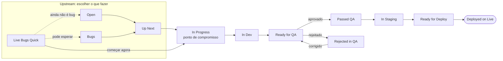

Toda task vive no **board "Flow"** da lista do ClickUp **FluxPrompt Platform Dev**. Esta página explica o que cada status significa, quando uma task entra nele e quem é dono dele. Os nomes dos status estão em inglês, exatamente como aparecem no ClickUp.

<Note>
O guia do time tem o mesmo fluxo com mais contexto: regras, métricas e as propostas que o time ainda está discutindo. Veja o [guia do time](https://claude.ai/artifact/7Cc2XCerrvzYSc6hF8QZwq). Esta página lista só o que está em uso hoje.
</Note>

## O fluxo num relance

O trabalho entra por duas portas: **Up Next** (trabalho planejado) e **Live Bugs Quick** (possíveis bugs reportados pelo cliente).

## Upstream: escolher o que fazer

Nada aqui é compromisso ainda. O lead time ainda não começou.

| Status | O que significa | Quem é dono |
| - | - | - |
| **Open** | Pedidos de produto, prioridades e ideias do cliente. O time do Brasil também pode adicionar itens, avisando o cliente. | Time do cliente (EUA), liderado por Brad e Evan |
| **Bugs** | Um bug triado esperando prioridade. Vai pra Up Next quando ganha prioridade. | Brad e Evan decidem a prioridade |
| **Up Next** | A fila de produto, em ordem. Os devs puxam do topo. | Brad e Evan definem a ordem |
| **Live Bugs Quick** | Possíveis bugs reportados pelo cliente, esperando uma primeira olhada rápida. Depois dessa olhada, o item vai direto pra In Progress ou espera em Bugs ou Open. | Cliente (EUA) e time do Brasil |

## Downstream: fazer o trabalho

Mova um card só quando o lado do git for verdade. Um card em Ready for QA promete que o QA consegue testar em dev agora mesmo.

| Status | O que significa | Lado do git | Quem é dono |
| - | - | - | - |
| **In Progress** | O ponto de compromisso. O dev refina o ticket, documenta e constrói a primeira versão. O lead time começa aqui. | Feature branch a partir da `main` | Devs do time do Brasil |
| **In Dev** | A mudança está mergeada em dev. Um PR aberto não basta. | Feature branch mergeada em `develop` | Devs do time do Brasil |
| **Ready for QA** | O deploy de dev terminou e a mudança está no ar em dev. O QA testa lá. | Deploy de dev terminado | QA do cliente (EUA): Brad, Evan, Justin e Bradley |
| **Rejected in QA** | O QA achou um problema. O motivo vai num comentário. Depois da correção, a task volta pra Ready for QA. | Correção mergeada em `develop` de novo | Devs do time do Brasil |
| **Passed QA** | O QA aprovou a mudança. Segue pra In Staging. | | Time do Brasil |
| **In Staging** | A mudança está em staging, a caminho de produção. Às vezes o time do Brasil testa aqui, às vezes o cliente. | Feature branch mergeada em `staging` | Varia |
| **Ready for Deploy** | Pronta pra ir pra produção. | PR na `main` revisado e mergeado | Time do Brasil |
| **Deployed on Live** | Em produção. A task está pronta. O Deployed Date é preenchido automaticamente quando o card vem pra cá. | Workflow de produção rodado na `main`, rollout conferido, deploy anunciado | Time do Brasil, na hora do deploy |

Os comandos de cada etapa estão em [Fluxo de git](/getting-started/pt-br/git-workflow).

### Paused

Uma task que parou depois de In Progress vai pra **Paused**. Quando ela desbloqueia, volta pro status em que estava.

<Warning>
Depois de In Progress, uma task não volta pra upstream. Se ela travou, mova pra Paused em vez de voltar pra Up Next ou Open.
</Warning>

## Deploys

- **Qualquer dia, menos sexta.** Na sexta, só correções críticas ou problemas urgentes vão pra produção.
- O time do Brasil faz o deploy, normalmente uma pessoa por dia. Todo mundo deve saber como fazer.
- Um deploy de produção entrega tudo que está mergeado na `main`. Faça merge de um PR na `main` só depois que a task dele passou no QA.
- Depois de um deploy de produção, poste o anúncio no Google Chat do time, uma linha por task do ClickUp. O agent `deploy-announcer` escreve pra você.

## Reuniões que movem o board

| Quando | O quê |
| - | - |
| Todo dia útil às 10:30 BRT | Daily do time do Brasil |
| Segunda, quarta e sexta às 13:30 BRT (14:30 BRT quando os EUA saem do horário de verão, do começo de novembro a meados de março) | Reunião com o cliente |
| A cada duas semanas | Retro com temas emergentes |

## Relacionados

- [Fluxo de git](/getting-started/pt-br/git-workflow): branches, PRs e comandos de deploy
- [Como a gente trabalha](/getting-started/welcome/pt-br/culture): code review e convenções
- [Guia do time](https://claude.ai/artifact/7Cc2XCerrvzYSc6hF8QZwq): o fluxo completo, regras, métricas e o padrão de ticket
