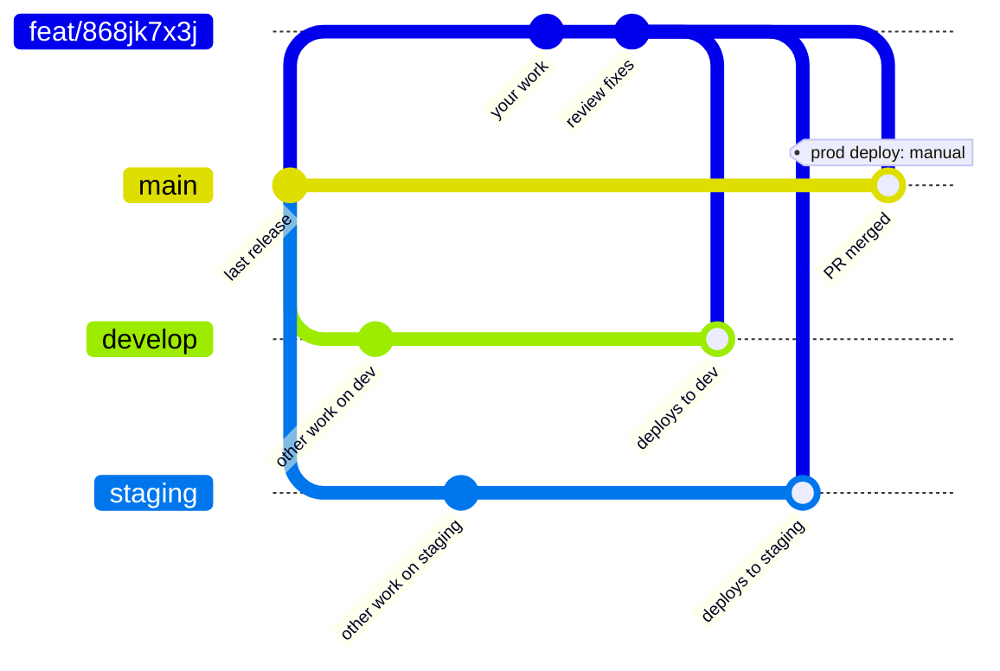
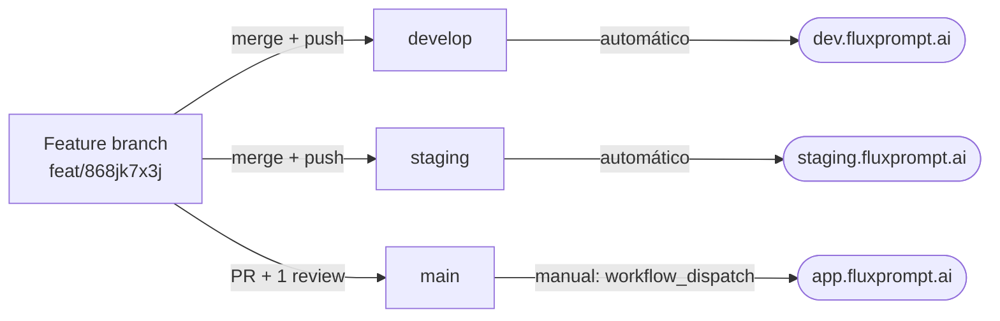

<Note>
**Os nomes das branches mudaram em 2026-10-13.** Todo repo de produto agora usa `develop` (dev), `staging` e `main` (produção). As branches antigas `production` e `master` ainda existem, mas estão congeladas: nunca crie branch a partir delas, nunca faça merge delas e nunca abra PR contra elas. No `front/`, a `main` era dev e agora é produção, então qualquer nota antiga que diga outra coisa está errada.
</Note>

Esta página é a referência de branches e deploys. Pros detalhes de AWS (topologia do ECS, resize de task definition), veja o playbook [PR and deploy flow](/ai-workflows/internal-developer-workflows/playbooks/pr-and-deploy-flow) (em inglês).

## Repos e branches

| Repo | Pasta no workspace | O que é | Dev | Staging | Produção |
| - | - | - | - | - | - |
| `Flux-Prompt` | `back/` | API (NestJS) | `develop` | `staging` | `main` |
| `Flux-Prompt-Frontend` | `front/` | Frontend (React) | `develop` | `staging` | `main` |
| `Flux-Prompt-Worker` | `worker/` | Worker (Temporal) | `develop` | `staging` | `main` |
| `FLuxPrompt-MCP` | `mcp-server/` | Servidor MCP | `develop` | `staging` | `main` |
| `docs` | `docs/` | Este site | | | `main` |
| `Workflow` | raiz do workspace | Agents, skills e scripts do time | | | `main` |

Em `docs` e `Workflow`, `main` é a única branch. Este site não faz deploy no merge: alguém clica em **Deploy** no [dashboard do Mintlify](https://dashboard.mintlify.com/enhancedai-ee242787/enhancedai-ee242787).

## Ambientes

| Ambiente | App | API | MCP | Como faz deploy |
| - | - | - | - | - |
| Dev | `dev.fluxprompt.ai` | `api-dev.fluxprompt.ai` | `mcp-dev.fluxprompt.ai` | Automaticamente a cada push em `develop` |
| Staging | `staging.fluxprompt.ai` | `api-staging.fluxprompt.ai` | `mcp-staging.fluxprompt.ai` | Automaticamente a cada push em `staging` |
| Produção | `app.fluxprompt.ai` | `api.fluxprompt.ai` | `mcp.fluxprompt.ai` | Só na mão, com `workflow_dispatch` na `main`. Um merge na `main` não faz deploy de nada |

Os servidores MCP de dev e staging desligam às 20:00 todo dia, então um 503 fora do horário é esperado.

## Nomenclatura

- **Branch:** `<change_type>/<task_code>`, onde `change_type` é `feat`, `fix` ou `refactor` e `task_code` é o ID da task no ClickUp. Exemplo: `feat/868jk7x3j`. Use o mesmo nome de branch em todo repo que a task tocar.
- **Título do PR:** `[FEAT] Imperative task name` (ou `[FIX]`, `[REFACTOR]`).
- **Body do PR:** Description, Preview, References. O agent `pr-creator` escreve pra você.
- Os repos não usam tags de versão.

## O fluxo



A sua feature branch é a origem. Ela entra em `develop` e `staging` por merge direto, e na `main` por um PR revisado. Mudanças nunca voltam de `develop` ou `staging` pra sua branch.

Onde cada branch faz deploy:



## Passo a passo

<Steps>
  <Step title="Crie a branch a partir da main">
    Antes de começar, confira se ninguém já tem uma branch pra task.
    ```bash
    git fetch origin
    git branch -r | grep 868jk7x3j
    git checkout --no-track -b feat/868jk7x3j origin/main
    ```
  </Step>
  <Step title="Teste em dev">
    Quando a mudança funcionar localmente, faça merge da sua branch em `develop`:
    ```bash
    git fetch origin
    git checkout develop
    git reset --hard origin/develop
    git merge --ff-only feat/868jk7x3j   # use a plain merge if a fast-forward isn't possible
    git push origin develop
    ```
    O push faz deploy em dev. Espere o deploy terminar antes de mover a task pra Ready for QA. Os deploys de dev gastam os minutos de GitHub Actions da organização, então teste localmente primeiro e faça push em dev pra confirmar, não pra iterar.
  </Step>
  <Step title="Promova pra staging">
    Depois que a task passar no QA, faça o mesmo com `staging`:
    ```bash
    git fetch origin
    git checkout staging
    git reset --hard origin/staging
    git merge --ff-only feat/868jk7x3j
    git push origin staging
    ```
  </Step>
  <Step title="Abra o PR na main com o pr-creator">
    ```
    use the pr-creator agent — https://app.clickup.com/t/868jk7x3j
    ```
    O agent encontra a branch em cada repo, roda `scripts/check-no-dev-in-prod-pr.sh`, escreve o título e o body e abre o PR contra a `main`. Preencha o **Preview** com screenshots ou logs antes de pedir review. Se a task tocar `back/` e `front/`, abra os dois PRs e entregue os dois juntos.
  </Step>
  <Step title="Consiga um review e faça o merge">
    Uma pessoa do time revisa cada PR. Responda todo comentário antes do merge. Comentários marcados com `nit:` são opcionais. O merge na `main` não faz deploy de nada.
  </Step>
  <Step title="Faça o deploy em produção">
    Rode o workflow de produção na `main` de cada repo que você mudou:
    ```bash
    gh workflow run cicd_prod.yml --ref main     # back/ and worker/
    gh workflow run cicd-prod.yaml --ref main    # front/
    gh workflow run cicd_prod.yml -f ref=main    # mcp-server/
    ```
    O run faz deploy de tudo que está na `main`, não só do seu PR. **Sem deploy em produção na sexta**, exceto correções críticas ou problemas urgentes.
  </Step>
  <Step title="Anuncie">
    Peça pro agent `deploy-announcer` escrever a mensagem, ou pro `pr-creator` se foi ele que abriu os PRs nesta sessão. Cole no Google Chat do time:
    ```
    Hey team, I just deployed the following to production:
    - <Task name> — https://app.clickup.com/t/<task_code>
    Please give me a shout if anything looks off after the rollout. Thanks!
    ```
  </Step>
</Steps>

## Regras

- A `main` só muda por um PR revisado e mergeado. Nunca faça merge ou commit direto nela.
- `develop` e `staging` recebem merge direto da sua feature branch. PR ali é opcional.
- Nunca escreva commits numa env branch (`main`, `staging`, `develop` ou as legadas `production` e `master`). O trabalho acontece na feature branch e entra por merge ou PR.
- Nunca faça merge de `develop`, `staging` ou `master` na sua feature branch. Isso leva toda mudança de dev pra produção: um PR que fez isso carregou 27 migrations que só existiam em dev, e produção não subiu até o revert. O `pr-creator` recusa uma branch assim. Pra corrigir, crie uma branch nova a partir de `origin/main` e faça cherry-pick só dos commits da task.
- Não use `--no-verify`. O hook de pre-commit bloqueia credenciais e arquivos `.env`.
- O acesso ao banco de produção é só leitura (`ec2-tunnel-prod`). Migrations passam por PR.

## Quando o GitHub Actions está bloqueado

A organização tem uma cota mensal de minutos de GitHub Actions. Quando ela acaba, os deploys de dev e de produção param. Nesse caso, faça o deploy da sua máquina com `scripts/deploy-direct/deploy.sh` e a skill `deploy-direct`. Comece todo tipo novo de run com `status` ou `--dry-run`. Um deploy de produção precisa de `--allow-prod` e de uma confirmação digitada, então você roda no seu próprio terminal.

## Relacionados

- [Fluxo de entrega](/getting-started/pt-br/delivery-workflow): o que cada status do ClickUp significa
- [PR and deploy flow](/ai-workflows/internal-developer-workflows/playbooks/pr-and-deploy-flow) (em inglês): topologia do ECS, checagens de rollout, resize
- [`pr-creator`](/ai-workflows/internal-developer-workflows/agents/pr-creator) (em inglês): automação de PR e do anúncio
