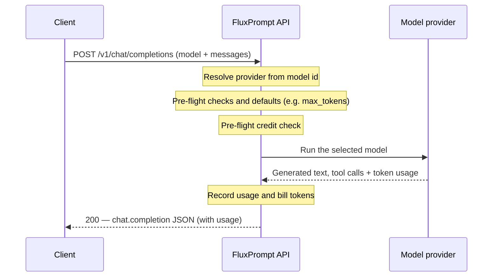
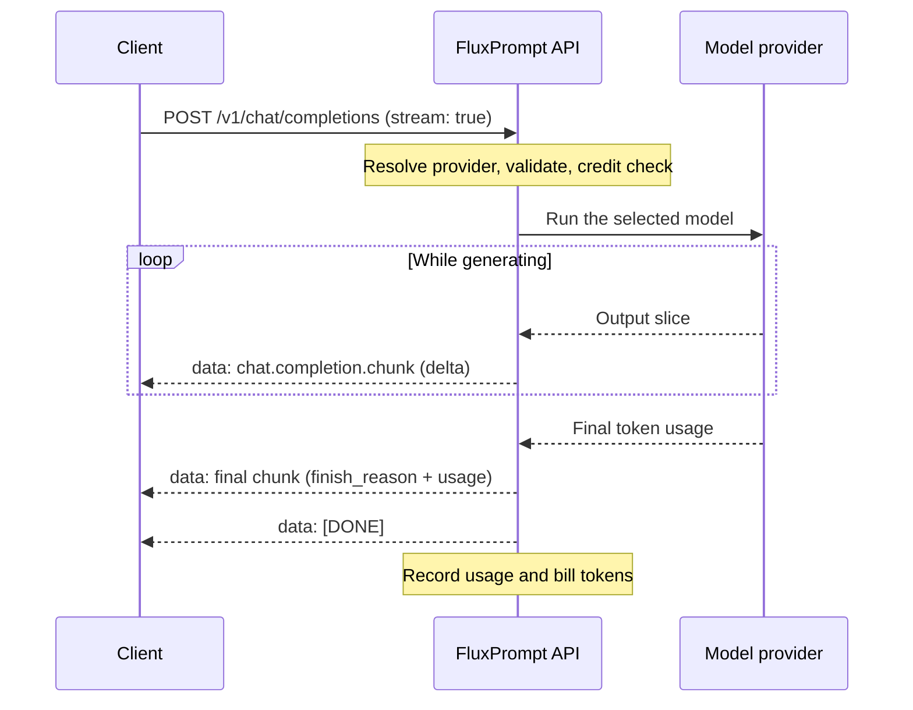

The Completions API takes a minimal request and turns it into a finished response. You send a `model` and a few fields; FluxPrompt resolves the provider, fills in the defaults the model needs, runs it, and returns the result. This page explains what happens between your request and the response, and how each request is billed.

## How a request flows

You send a request with a `model` id and a few fields (such as `messages` and an optional `max_tokens`) to `/v1/chat/completions` (OpenAI format) or `/v1/messages` (Anthropic format). FluxPrompt resolves the right provider from the model id, validates the request, fills in any missing parameters from the model's metadata, routes the request to the selected model provider, and returns a response in the same wire format you used. When you set `stream: true`, the same path streams the output back to you as it is generated.

<Info>
`/v1/messages` is a translation layer over the same pipeline as `/v1/chat/completions`. FluxPrompt converts the Messages request into a chat completion request, so validation, model gating, image handling, billing, and logging behave the same on both endpoints.
</Info>

### Non-streaming

With `stream: false` (the default), you get a single JSON response once the model finishes.

### Streaming

With `stream: true`, the response is returned as server-sent events. On `/v1/chat/completions`, you receive a series of `chat.completion.chunk` events, a final chunk carrying `usage`, then a literal `data: [DONE]` line. On `/v1/messages`, you receive the Anthropic event sequence, from `message_start` to `message_stop`. See [Streaming](/main-api/specific-features/completions-api/chat-completions#streaming) and [Messages](/main-api/specific-features/completions-api/messages#streaming).

The stream opens when the first output arrives, or after 10 seconds if the model has not produced anything yet. While the stream is open, FluxPrompt sends a keep-alive every 15 seconds so proxies do not close an idle connection. A streamed request can run for up to 12 minutes.

<Note>
The pre-flight checks run before the stream opens. If one fails, or if the provider fails before the first output, you get a regular JSON error with the matching HTTP status instead of a half-open stream. If a failure happens after the stream opens, the error arrives as a final event in the stream.
</Note>

## Pre-flight checks

Before FluxPrompt calls the model, it checks the request in this order. The first check that fails ends the request, and nothing is billed.

| Check | Failure |
| --- | --- |
| The body is valid: required fields, types, and [limits](/main-api/specific-features/completions-api/chat-completions#limits) | `400 invalid_request_error` |
| The model exists and is active, and is not deprecated unless you opted in to substitution | `400 model_not_found`, `400 model_deprecated` |
| The model's provider is supported by this API | `400 unsupported_provider` |
| The model accepts images, when the request has images | `400 model_not_vision_capable` |
| The model supports tool calling, when the request has tools | `400 model_not_tool_capable`, `400 invalid_tool_choice` |
| The cache markers are valid | `400 cache_ttl_not_supported`, `400 too_many_cache_markers` |
| The provider options do not change the price | `400 unsupported_provider_option` |
| The model is enabled for your company | `403 model_not_enabled` |
| The account has an active subscription and credits | `402 insufficient_quota` |

For the full list of errors, see the [Chat completions error table](/main-api/specific-features/completions-api/chat-completions#errors).

## Large requests

FluxPrompt keeps long conversations out of the execution path's size limits. When the messages of a request are larger than 256 KB, FluxPrompt stores them temporarily in S3 and hands the model runner a short-lived signed link instead of the full payload. Inline base64 images are handled the same way. FluxPrompt deletes these temporary objects when the call ends.

## Billing

Requests are billed in tokens (flux). Each request is metered in two parts — **input** tokens (your prompt) and **output** tokens (the model's response) — and priced according to the model you call.

### What gets billed

<Steps>
  <Step title="Input and output tokens">
    Every request is billed on the tokens it uses, split into input and output. Each model has its own price, so the cost depends on which model you call and how much text goes in and comes out.
  </Step>
  <Step title="Per-request usage">
    The token counts for each request are returned in the `usage` object of the response and recorded against your account, so usage is traceable per request. When the model uses prompt caching, `usage` also reports the cache read and cache write tokens. See [Prompt caching](/main-api/specific-features/completions-api/chat-completions#prompt-caching).
  </Step>
  <Step title="Charged after the model runs">
    Tokens are billed once the request completes, using the actual usage reported by the model.
  </Step>
</Steps>

### Pre-flight credit check

Before the model runs, FluxPrompt verifies that your account can pay for the request. If the account has no active subscription or no remaining credits, the request is rejected with `402 insufficient_quota` **before** the model is called.

<Check>
Because the credit check happens before the model runs, you are never charged for a request that did not run.
</Check>

### Streaming is billed the same way

Streaming requests are billed on the same input/output token basis. The charge is applied **after the stream completes**, using the authoritative token usage from the final chunk. There is no double-charge — a streamed request is billed exactly once.

### Traceability

Token usage is recorded per request and tied to your account, so you can reconcile what you were billed against the `usage` returned by each response. Company admins can also inspect each request in [Completion logs](/main-api/specific-features/completions-api/completion-logs).

<Info>
The `402 insufficient_quota` error is enforced by the pre-flight credit check. It is the same error documented in the [Chat completions](/main-api/specific-features/completions-api/chat-completions#errors) error table. On `/v1/messages`, the same condition returns a `402` with the Anthropic error type `billing_error`.
</Info>

## Related behavior

A few request behaviors are worth keeping in mind as you read the flow above:

| Behavior | Summary |
| --- | --- |
| Authentication | `/v1/chat/completions` and `/v1/models` authenticate with the `api-key` header (user key or company-space key). `/v1/messages` also accepts `x-api-key` and bearer tokens. |
| Provider resolution | The provider (Anthropic, OpenAI, Google Gemini, Groq, Perplexity, xAI, Moonshot, Mistral, TypeSafe, or Cloudflare Workers AI) is derived from the `model` id — you never send a provider name. |
| Deprecated models | `deprecated_model_behavior` controls whether a deprecated model errors or is transparently substituted. |
| OpenAI compatibility | Requests and responses on `/v1/chat/completions` match OpenAI, so OpenAI SDKs work by swapping the base URL. |
| Anthropic compatibility | Requests and responses on `/v1/messages` match the Anthropic Messages API, so Anthropic SDKs and Claude Code work by swapping the base URL. |

## What's next

<CardGroup cols={2}>
  <Card title="Completions API overview" icon="compass" href="/main-api/specific-features/completions-api/overview">
    What the endpoints are, the providers they support, and how authentication works.
  </Card>
  <Card title="Chat completions" icon="message-square" href="/main-api/specific-features/completions-api/chat-completions">
    Full request parameters, response shape, streaming details, and the error table.
  </Card>
  <Card title="Messages" icon="messages-square" href="/main-api/specific-features/completions-api/messages">
    The Anthropic-compatible endpoints.
  </Card>
</CardGroup>
