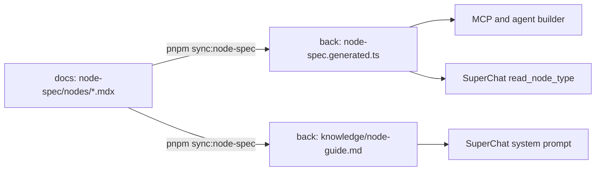

## What this is

Each node type has one page under `node-spec/nodes/`. The page is the specification of that node: its fields, their types and accepted values, its output, and its handles. Every place that describes a node to a machine reads it from here:

| Reader | What it serves | Where it lives in back |
|--------|----------------|------------------------|
| MCP | `list_node_types`, `get_node_type` and the `fluxprompt://node-types` resource | `src/app-mcp/node-types/node-types.service.ts` |
| SuperChat | `read_node_type`, the node index and the node guide in its system prompt | `src/app-api/superchat/` |
| Agent builder | the node knowledge the builder plans with | `src/agent-engine/knowledge/node-registry.ts` |

Before this page existed, the same content lived in back `src/app-mcp/node-types/node-type-metadata.ts` (about 4,000 lines) and SuperChat's node guide was a separate Markdown file. Both are now generated from these pages.

## How a change reaches the product



1. Edit the node page in this repo.
2. In back, run the sync against your docs checkout:

   ```bash
   DOCS_REPO_PATH=../docs pnpm sync:node-spec
   ```

   Without `DOCS_REPO_PATH`, the sync looks for a `docs` checkout next to back. It validates every page and writes two files: `src/app-mcp/node-types/node-spec.generated.ts` and `src/app-api/superchat/knowledge/node-guide.md`. Never edit either by hand.
3. Commit the generated files in back and open both PRs. The back PR links the docs PR.

`pnpm sync:node-spec --check` exits with an error when the generated files no longer match the pages. The spec `node-spec-sync.spec.ts` runs the same check in Jest whenever it can find the docs checkout, and skips when it cannot.

## Why a build-time bundle, not a runtime fetch

The sync copies the pages into back at build time. Back never fetches this site at run time.

- **No network dependency in production.** The MCP and SuperChat answer from a file in the deployed image. A docs outage, a slow fetch or a cache miss cannot change what they serve.
- **A change is reviewed and tested where it runs.** The generated file goes through a back PR, and back's specs run on the exact content production will serve. A fetch with cache would let a docs merge change production behaviour with no back test run.
- **Versions stay paired.** A back release always carries the specification it was tested with, so a rollback rolls the specification back too.

The cost is one extra step: a docs change reaches production only after back syncs it and deploys. The drift check makes a forgotten sync visible.

## Anatomy of a node page

Every page in `node-spec/nodes/` has the same parts:

| Part | Required | Rule |
|------|----------|------|
| File name | Yes | The type in kebab case: `commandTextNode` → `command-text-node.mdx`. |
| Frontmatter `title`, `sidebarTitle` | Yes | The name a person reads. Not read by the sync. |
| Frontmatter `description` | Yes | A JSON string equal to the block's `description`. The sync fails when they differ. |
| `markdown superchat-guide` block | No | The node's section of SuperChat's node guide, word for word. See [SuperChat node guide](/node-spec/superchat-guide). |
| `json node-spec` block | Yes | Exactly one per page. The machine-readable specification below. |
| Related pages | No | Links to the worker or client pages for the node. |

### The `node-spec` block

| Field | Type | What it holds |
|-------|------|---------------|
| `type` | string | The technical type stored on the node, such as `commandTextNode`. Unique across pages. |
| `label` | string | The technical name. The MCP composes it with the sidebar name, for example `Display Box (Output Controller)`. |
| `category` | string | One of the [node categories](/node-spec/categories). |
| `description` | string | What the node does. The MCP and SuperChat serve it as written. |
| `inputSchema` | JSON Schema object | The fields stored in the node's `data`: names, types, `enum` values, `required`, and the `<field>Data` arrays an edge fills. |
| `outputSchema` | JSON Schema object | What a run of the node returns. |
| `handles` | object | The node's connection points, exactly as `get_node_type` returns them: `sourceHandles` with their `role`, `targetHandles` with the `dataField` an edge feeds, `patterned` handles, and `canContinueExecutionChain`. |
| `implementation` | object | Where the node lives in code and which `data` fields that code uses: `frontComponent`, `frontFields`, `workerModule` and `workerFields`. Back extracts these; see [the field check](#field-check). |
| `internalFields` | object | Fields the code uses that are deliberately not in `inputSchema`, each with the reason. Fields every node carries are on [Shared node fields](/node-spec/shared-fields) instead. |
| `review` | object | `fieldsCheckedOn`: the date the fields were last checked against the front component, the worker module and stored nodes, or `null`. `realRunCheckedOn`: the date a real run proved the node delivers its output, or `null`. |

Write `inputSchema` from the code, never from memory. A field that does not exist is stored happily by the MCP and then ignored at run time, so the node looks configured and does nothing. Check the front component, the worker module and stored node data before you add or rename a field.

### Handles come from the front

`handles` is a published copy, not a second source. Back generates the handle registry from the front components (`pnpm generate:node-handle-registry`), and `node-spec-sync.spec.ts` fails when a page's `handles` differ from what back derives. When a front component changes its handles, regenerate the registry in back, then copy the new `handles` from `get_node_type` into the page.

## Field check

Back reads the code of every node and records, in `implementation`, which `data` fields it uses:

- **Front:** the component `front/src/util/nodeTypes.tsx` maps the type to, plus the files it imports under `src/components/` (shared `src/components/UI/` excluded). A field counts when the code reads `data.<field>`, destructures it from `data`, or writes it through `objectData` in an autosave call.
- **Worker:** the module that executes the type. A field counts when it is a member of the node data interface the module passes to `fetchNodeRow` or `NodeRow`, or, for a module without that interface, when the code reads `nodeData.<field>`.

Two specs in back use it:

| Spec | Fails when | Runs |
|------|-----------|------|
| `node-spec-fields.spec.ts`, field check | A page with `review.fieldsCheckedOn` set has a code field that is neither in `inputSchema`, `outputSchema`, `internalFields` nor [Shared node fields](/node-spec/shared-fields); an `internalFields` entry the code no longer uses; or a field both declared and internal. | Always |
| `node-spec-fields.spec.ts`, implementation drift | A front component or worker module now uses a different set of fields than the page's `implementation` records. | When back finds the front and worker checkouts (`FRONT_REPO_PATH`, `WORKER_REPO_PATH`, or siblings); skipped otherwise |

So a change to a node's data shape in front or worker fails the drift spec until someone updates the node page. When it fails:

1. Run `pnpm generate:node-field-footprint` in back and copy the type's new `implementation` into the page.
2. For each new field, add it to `inputSchema` when a client can set it, or explain it in `internalFields`. Remove what the code dropped.
3. Run `pnpm sync:node-spec`, then `pnpm sync:node-spec --report` to see what is still unexplained.

The extractor misses fields a helper reads through another variable name, and fields only back reads. A field in `inputSchema` that `implementation` does not list is therefore not an error by itself: check it by hand in the component, the worker module and stored node data before you call it invented.

## What the sync checks

The sync refuses to write and names every problem it finds:

- each page has exactly one `node-spec` block of valid JSON, and at most one `superchat-guide` block;
- `type`, `label` and `description` are non-empty, and no two pages declare the same `type`;
- the file name matches the type;
- `category` is declared on [Node categories](/node-spec/categories);
- `inputSchema` and `outputSchema` are objects with `type: "object"`;
- `handles` has its three arrays and three flags;
- `implementation` has its two paths (or `null`) and two field lists, `internalFields` maps each field to a reason, and `review` holds dates or `null`;
- the frontmatter `description` equals the block `description`;
- the [SuperChat guide order](/node-spec/superchat-guide) lists every page with a guide block, once, and nothing else.

Back's specs then check what needs the code: every `NodeType` has a page, the `handles` match the registry, and the `<field>Data` arrays follow the companion rules in `node-type-contract.spec.ts`.

## What does not live here

- **Which fields are redacted in run logs.** That is a privacy policy, so it stays in back (`REDACTABLE_FIELDS_BY_NODE_TYPE` in `node-type-metadata.ts`). Its spec fails if it names a field the specification does not declare.
- **How a node executes.** Worker or back, prefetch, legacy endpoint: see the dispatch registry (`node-dispatch-contract.json`) and [how to add a node type](/worker/how-to-add-a-node-type).
- **Builder defaults.** The agent builder compiles default `data` for a node through its own factory.

## Translations

The node pages, [Node categories](/node-spec/categories) and [SuperChat node guide](/node-spec/superchat-guide) are English only on purpose: each holds a machine-readable block, and a translated copy would be a second source. The Portuguese navigation links to the English pages. This page has a Portuguese version.
