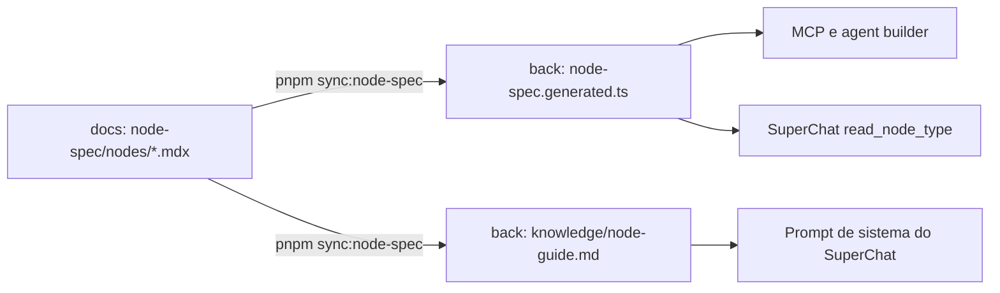

## O que é

Cada tipo de nó tem uma página em `node-spec/nodes/`. A página é a especificação daquele nó: seus campos, os tipos e valores aceitos, a saída e os handles. Todo lugar que descreve um nó para uma máquina lê daqui:

| Leitor | O que serve | Onde fica no back |
|--------|-------------|-------------------|
| MCP | `list_node_types`, `get_node_type` e o recurso `fluxprompt://node-types` | `src/app-mcp/node-types/node-types.service.ts` |
| SuperChat | `read_node_type`, o índice de nós e o guia de nós no prompt de sistema | `src/app-api/superchat/` |
| Agent builder | o conhecimento de nós com que o builder planeja | `src/agent-engine/knowledge/node-registry.ts` |

Antes desta página, o mesmo conteúdo ficava no back em `src/app-mcp/node-types/node-type-metadata.ts` (cerca de 4.000 linhas), e o guia de nós do SuperChat era um arquivo Markdown separado. Os dois agora são gerados a partir destas páginas.

## Como uma mudança chega ao produto



1. Edite a página do nó neste repositório.
2. No back, rode o sync apontando para o seu checkout do docs:

   ```bash
   DOCS_REPO_PATH=../docs pnpm sync:node-spec
   ```

   Sem `DOCS_REPO_PATH`, o sync procura um checkout `docs` ao lado do back. Ele valida todas as páginas e escreve dois arquivos: `src/app-mcp/node-types/node-spec.generated.ts` e `src/app-api/superchat/knowledge/node-guide.md`. Nunca edite nenhum dos dois à mão.
3. Faça commit dos arquivos gerados no back e abra os dois PRs. O PR do back aponta para o PR do docs.

`pnpm sync:node-spec --check` termina com erro quando os arquivos gerados não batem mais com as páginas. O spec `node-spec-sync.spec.ts` roda a mesma checagem no Jest sempre que encontra o checkout do docs, e é pulado quando não encontra.

## Por que um bundle no build, e não um fetch em runtime

O sync copia as páginas para o back no build. O back nunca busca este site em runtime.

- **Nenhuma dependência de rede em produção.** O MCP e o SuperChat respondem a partir de um arquivo da imagem publicada. Uma queda do docs, um fetch lento ou um cache vazio não mudam o que eles servem.
- **A mudança é revisada e testada onde roda.** O arquivo gerado passa por um PR do back, e os specs do back rodam sobre o conteúdo exato que produção vai servir. Um fetch com cache deixaria um merge no docs mudar o comportamento de produção sem nenhum teste do back.
- **As versões andam juntas.** Um release do back sempre carrega a especificação com que foi testado, então um rollback também volta a especificação.

O custo é um passo a mais: uma mudança no docs só chega a produção depois que o back sincroniza e faz deploy. A checagem de drift deixa um sync esquecido visível.

## Anatomia de uma página de nó

Toda página em `node-spec/nodes/` tem as mesmas partes:

| Parte | Obrigatória | Regra |
|-------|-------------|-------|
| Nome do arquivo | Sim | O tipo em kebab case: `commandTextNode` → `command-text-node.mdx`. |
| `title`, `sidebarTitle` do frontmatter | Sim | O nome que uma pessoa lê. O sync não lê. |
| `description` do frontmatter | Sim | Uma string JSON igual ao `description` do bloco. O sync falha quando diferem. |
| Bloco `markdown superchat-guide` | Não | A seção do nó no guia de nós do SuperChat, palavra por palavra. Veja [SuperChat node guide](/node-spec/superchat-guide). |
| Bloco `json node-spec` | Sim | Exatamente um por página. A especificação legível por máquina abaixo. |
| Páginas relacionadas | Não | Links para as páginas do worker ou do client sobre o nó. |

### O bloco `node-spec`

| Campo | Tipo | O que guarda |
|-------|------|--------------|
| `type` | string | O tipo técnico gravado no nó, como `commandTextNode`. Único entre as páginas. |
| `label` | string | O nome técnico. O MCP o compõe com o nome da sidebar, por exemplo `Display Box (Output Controller)`. |
| `category` | string | Uma das [categorias de nós](/node-spec/categories). |
| `description` | string | O que o nó faz. O MCP e o SuperChat servem o texto como está. |
| `inputSchema` | objeto JSON Schema | Os campos gravados no `data` do nó: nomes, tipos, valores de `enum`, `required` e os arrays `<field>Data` que uma aresta preenche. |
| `outputSchema` | objeto JSON Schema | O que uma execução do nó devolve. |
| `handles` | objeto | Os pontos de conexão do nó, exatamente como `get_node_type` devolve: `sourceHandles` com seu `role`, `targetHandles` com o `dataField` que uma aresta alimenta, handles `patterned` e `canContinueExecutionChain`. |
| `implementation` | objeto | Onde o nó vive no código e quais campos de `data` esse código usa: `frontComponent`, `frontFields`, `workerModule` e `workerFields`. O back extrai esses valores; veja [a checagem de campos](#checagem-de-campos). |
| `internalFields` | objeto | Campos que o código usa e que ficam fora do `inputSchema` de propósito, cada um com o motivo. Campos que todo nó carrega ficam em [Shared node fields](/node-spec/shared-fields). |
| `review` | objeto | `fieldsCheckedOn`: a data em que os campos foram conferidos pela última vez contra o componente do front, o módulo do worker e nós gravados, ou `null`. `realRunCheckedOn`: a data em que uma execução real provou que o nó entrega sua saída, ou `null`. |

Escreva o `inputSchema` a partir do código, nunca de memória. Um campo que não existe é gravado sem erro pelo MCP e depois ignorado na execução, então o nó parece configurado e não faz nada. Confira o componente do front, o módulo do worker e dados de nós gravados antes de adicionar ou renomear um campo.

### Os handles vêm do front

`handles` é uma cópia publicada, não uma segunda fonte. O back gera o registro de handles a partir dos componentes do front (`pnpm generate:node-handle-registry`), e o `node-spec-sync.spec.ts` falha quando os `handles` de uma página diferem do que o back deriva. Quando um componente do front muda seus handles, regenere o registro no back e copie os novos `handles` de `get_node_type` para a página.

## Checagem de campos

O back lê o código de cada nó e registra, em `implementation`, quais campos de `data` ele usa:

- **Front:** o componente para o qual `front/src/util/nodeTypes.tsx` mapeia o tipo, mais os arquivos que ele importa em `src/components/` (exceto o compartilhado `src/components/UI/`). Um campo conta quando o código lê `data.<campo>`, o desestrutura de `data`, ou o grava via `objectData` numa chamada de autosave.
- **Worker:** o módulo que executa o tipo. Um campo conta quando é membro da interface de dados do nó que o módulo passa para `fetchNodeRow` ou `NodeRow`, ou, num módulo sem essa interface, quando o código lê `nodeData.<campo>`.

Dois specs do back usam isso:

| Spec | Falha quando | Roda |
|------|--------------|------|
| `node-spec-fields.spec.ts`, checagem de campos | Uma página com `review.fieldsCheckedOn` preenchido tem um campo de código que não está em `inputSchema`, `outputSchema`, `internalFields` nem em [Shared node fields](/node-spec/shared-fields); uma entrada de `internalFields` que o código não usa mais; ou um campo declarado e interno ao mesmo tempo. | Sempre |
| `node-spec-fields.spec.ts`, drift de implementação | Um componente do front ou módulo do worker passa a usar um conjunto de campos diferente do que o `implementation` da página registra. | Quando o back encontra os checkouts do front e do worker (`FRONT_REPO_PATH`, `WORKER_REPO_PATH`, ou irmãos); pulado caso contrário |

Assim, uma mudança no formato de dados de um nó no front ou no worker faz o spec de drift falhar até alguém atualizar a página do nó. Quando ele falhar:

1. Rode `pnpm generate:node-field-footprint` no back e copie o novo `implementation` do tipo para a página.
2. Para cada campo novo, adicione-o ao `inputSchema` quando um cliente puder preenchê-lo, ou explique-o em `internalFields`. Remova o que o código deixou de usar.
3. Rode `pnpm sync:node-spec` e depois `pnpm sync:node-spec --report` para ver o que ainda está sem explicação.

O extrator não enxerga campos que um helper lê por outro nome de variável, nem campos que só o back lê. Um campo do `inputSchema` que o `implementation` não lista não é, sozinho, um erro: confira-o à mão no componente, no módulo do worker e em dados de nós gravados antes de dizer que ele foi inventado.

## O que o sync confere

O sync se recusa a escrever e lista cada problema que encontra:

- cada página tem exatamente um bloco `node-spec` com JSON válido, e no máximo um bloco `superchat-guide`;
- `type`, `label` e `description` não estão vazios, e duas páginas não declaram o mesmo `type`;
- o nome do arquivo bate com o tipo;
- `category` está declarada em [Node categories](/node-spec/categories);
- `inputSchema` e `outputSchema` são objetos com `type: "object"`;
- `handles` tem seus três arrays e três flags;
- `implementation` tem seus dois caminhos (ou `null`) e duas listas de campos, `internalFields` liga cada campo a um motivo, e `review` guarda datas ou `null`;
- o `description` do frontmatter é igual ao `description` do bloco;
- a [ordem do guia do SuperChat](/node-spec/superchat-guide) lista uma vez cada página com bloco de guia, e nada além disso.

Os specs do back então conferem o que depende do código: todo `NodeType` tem uma página, os `handles` batem com o registro, e os arrays `<field>Data` seguem as regras de companheiros do `node-type-contract.spec.ts`.

## O que não fica aqui

- **Quais campos são ocultados nos logs de execução.** É uma política de privacidade, então fica no back (`REDACTABLE_FIELDS_BY_NODE_TYPE` em `node-type-metadata.ts`). O spec dele falha se citar um campo que a especificação não declara.
- **Como um nó executa.** Worker ou back, prefetch, endpoint legado: veja o registro de dispatch (`node-dispatch-contract.json`) e [como adicionar um tipo de nó](/worker/pt-br/how-to-add-a-node-type).
- **Defaults do builder.** O agent builder compila o `data` padrão de um nó pela própria factory.

## Traduções

As páginas de nós, [Node categories](/node-spec/categories) e [SuperChat node guide](/node-spec/superchat-guide) ficam só em inglês de propósito: cada uma guarda um bloco legível por máquina, e uma cópia traduzida seria uma segunda fonte. A navegação em português aponta para as páginas em inglês. Esta página tem versão em português.
